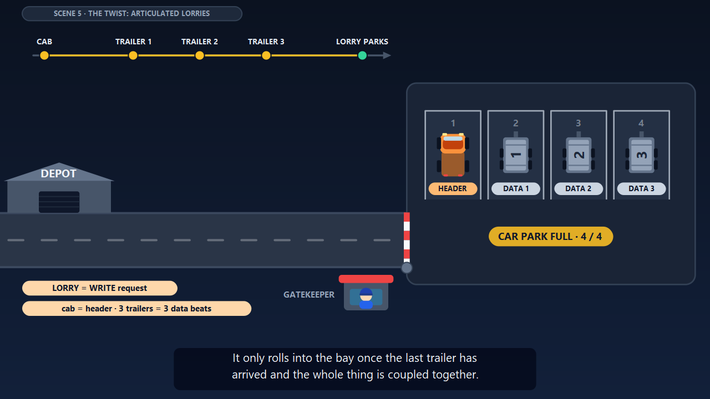
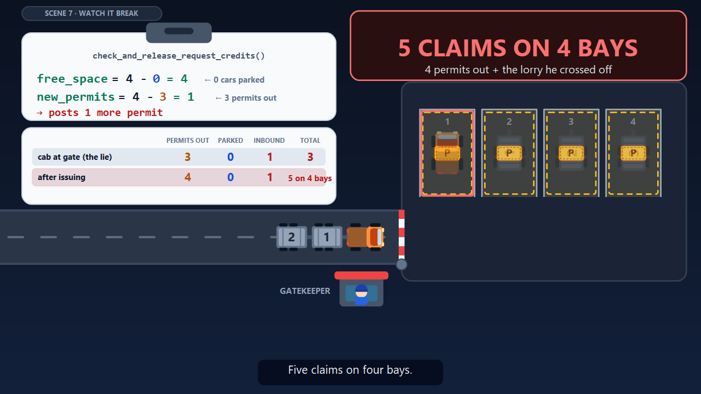
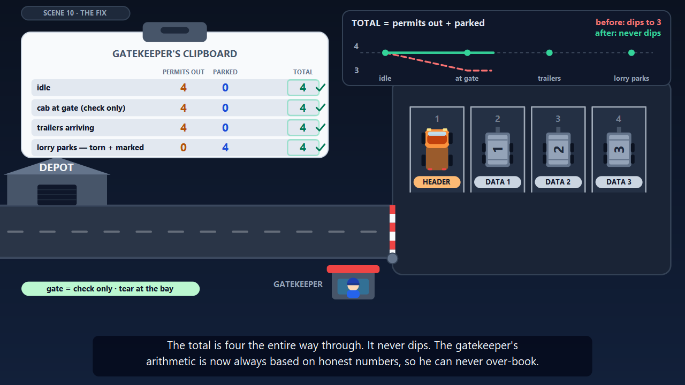
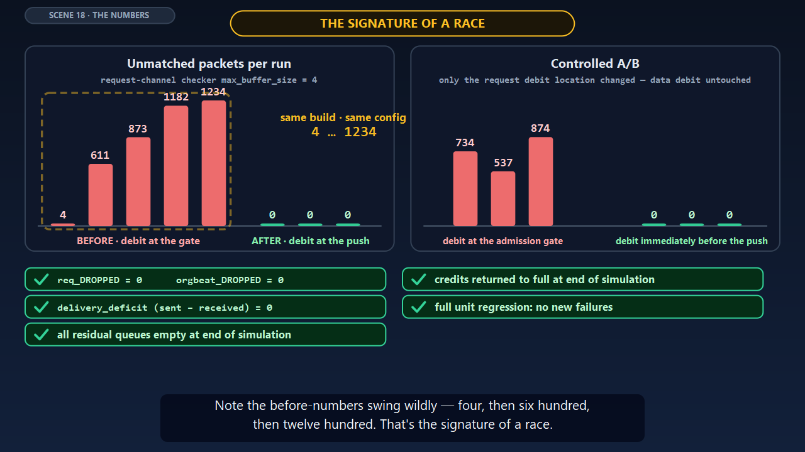

# The Parking Permit Bug — an animated explainer

A 13-minute narrated animation that explains a **credit-accounting bug in the UALink UPLI request path**: why reducing
`max_buffer_size` to 4 caused intermittent dropped requests, and how moving *one existing call* fixed it.

The story is told with a car park (the RX buffer), permits (credits), a gatekeeper (the credit manager) and articulated
lorries (WRITE requests made of a header plus data beats). Part 2 maps every element back onto the real code, and Part 3
shows the evidence.

Everything is generated from code: SVG scenes are rendered frame by frame, the voice-over comes from text-to-speech, and
ffmpeg assembles the result. There is nothing to edit by hand, and no video editor is needed.

| | |
|---|---|
|  |  |
|  |  |

## What you get

| Part | Scenes | Length | Content |
|---|---|---|---|
| 1 — The Car Park | 1–9 | 5:25 | The analogy: permits, the golden rule, motorbikes vs lorries, the bug, the silent failure, why nobody noticed |
| 2 — Same Story, in Code | 10–17 | 5:04 | The fix, why "just before parking", two car parks, the analogy→code mapping, the defect line by line |
| 3 — The Evidence | 18–19 + appendices | 2:35 | The numbers, the takeaway, how to reproduce, how to check the fix is intact |

`python -m ualink_video all` builds the three parts and joins them into one film with chapter markers.
The narrative itself is in [`script/parking_permit_credit_bug.md`](script/parking_permit_credit_bug.md).

## Quick start

```bash
git clone <this repo> && cd <this repo>
python -m venv .venv && source .venv/bin/activate     # Windows: .venv\Scripts\activate
pip install -r requirements.txt                      # + the native Cairo library, see below
python -m ualink_video doctor                        # checks everything the build needs
python -m ualink_video all                           # ~30-45 min, writes out/parking_permit_bug_full.mp4
```

The narration clips are committed in [`narration/`](narration), so **the build needs no internet access** and always uses
the same voice. To look at a single frame before committing to a full render:

```bash
python -m ualink_video still --part 1 12.5 40        # -> build/stills/part1_0012.50.png ...
```

## Requirements

* **Python 3.9+** (developed on 3.13).
* **The Python packages** in `requirements.txt`: `cairosvg` (SVG → PNG), `edge-tts` (voice-over, only needed to
  regenerate narration), `imageio-ffmpeg` (ships an ffmpeg binary, so you do not need to install ffmpeg), `numpy`.
* **The native Cairo library**, which `cairosvg` loads at runtime (see next section).
* **Two fonts** (see [Fonts](#fonts)). On Windows the defaults are already installed.
* About 1 GB of free disk space while rendering (frames are deleted after each part is encoded), and several CPU cores.

### Install Cairo

`pip install cairosvg` does not install the Cairo C library. If `doctor` reports that `cairosvg` failed to import:

| OS | Command |
|---|---|
| **Windows** | Easiest with conda: `conda install -c conda-forge cairo`. Without conda, install the [GTK 3 runtime for Windows](https://github.com/tschoonj/GTK-for-Windows-Runtime-Installer) and make sure its `bin` folder is on `PATH`. Restart the terminal afterwards. |
| **macOS** | `brew install cairo libffi`. If Python still cannot find it: `export DYLD_FALLBACK_LIBRARY_PATH=$(brew --prefix)/lib` |
| **Debian / Ubuntu** | `sudo apt install libcairo2 fonts-dejavu-core` |
| **Fedora** | `sudo dnf install cairo dejavu-sans-fonts dejavu-sans-mono-fonts` |

### Fonts

The layout was tuned with **Segoe UI** (text) and **Consolas** (code), which Windows ships. On other systems the build
falls back to *DejaVu Sans / DejaVu Sans Mono* (Linux) or *Helvetica Neue / Menlo* (macOS). Cairo silently substitutes
a default font when a family is missing, so `doctor` tells you whether each configured font is really installed.

You can use any fonts by setting environment variables:

| Variable | Meaning | Default |
|---|---|---|
| `UALINK_FONT_SANS` | text font family name | `Segoe UI` / `Helvetica Neue` / `DejaVu Sans` |
| `UALINK_FONT_MONO` | code font family name | `Consolas` / `Menlo` / `DejaVu Sans Mono` |
| `UALINK_MONO_ADVANCE` | width of one code character as a fraction of the font size — needed so multi-colour code lines line up | `0.55` / `0.602` / `0.602` |

Approximate advances: Consolas 0.55, Cascadia Mono 0.586, DejaVu Sans Mono / Menlo 0.602, Liberation Mono / Courier New /
JetBrains Mono 0.6, Inconsolata 0.5. Narrower code fonts fit the code panels best. For example:

```bash
UALINK_FONT_SANS="Open Sans" UALINK_FONT_MONO="Inconsolata" UALINK_MONO_ADVANCE=0.5 python -m ualink_video doctor
```
(PowerShell: `$env:UALINK_FONT_MONO="Inconsolata"; $env:UALINK_MONO_ADVANCE="0.5"`.)
Different fonts change spacing slightly; the content and timing are unaffected.

## Usage

Run every command from the repository root. `python -m ualink_video --help` lists them all.

| Command | What it does |
|---|---|
| `doctor` | Checks Python, packages, Cairo, ffmpeg, both fonts, and that every narration clip exists and matches the current text. |
| `all [--parts 1 2 3] [--hd]` | Narration (if needed) → render each part → join them. The join only happens when all three parts exist. |
| `video --part N [--hd] [--workers W] [--keep-frames]` | Render one part to `out/partN_*.mp4`. |
| `still --part N T [T ...]` | Render single frames at the given times (seconds) to `build/stills/`. Timestamps come from `build/timeline<N>.json`. |
| `timeline --part N` | Lay the beats out in time using the real narration lengths → `build/timeline<N>.json` and `build/audio<N>.wav`. |
| `tts [--force] [--parts ...]` | Generate missing or out-of-date narration clips with edge-tts (needs internet). |
| `concat` | Join `out/part1…3` into `out/parking_permit_bug_full.mp4` with three chapters. |

Notes:

* **Speed.** Frames render in parallel, one process per CPU core minus two. About 30 minutes for everything at 1280×720 on
  a 12-thread machine; `--hd` (1920×1080) takes roughly twice as long. Use `--workers` to change the process count.
* **Outputs** go to `out/` and scratch files to `build/`; both are git-ignored.
* **The join** is a clean dip through black with no click or flash, because every part starts and ends on black and silence.
* On Windows and macOS the renderer starts worker processes, so always run it as `python -m ualink_video ...`, not by
  importing the modules from your own script without a `if __name__ == "__main__":` guard.

## How it works

```
beats_part*.py ──► tts ──► narration/*.mp3 ──► timeline ──► build/timeline<N>.json + audio<N>.wav
 (what is said,      (edge-tts)                 (real clip                │
  one line per                                   lengths set the          ▼
  visual step)                                   scene timing)    render frames: frame_svg(t) → SVG → PNG
                                                                         │                 (cairosvg, parallel)
                                                                         ▼
                                                        ffmpeg: frames + audio → out/partN.mp4 ──► concat
```

* The script is split into **beats**: one sentence or short group of sentences, each mapped to one visual step.
  A scene is a function `sceneN(t, T, D, L)` that returns an SVG string for scene-local time `t`;
  `T[i]`/`D[i]` are the start and length of beat `i`, so animations are written relative to the narration.
* Timing comes from the audio: the timeline is built from the real duration of each narration clip, so changing the
  wording changes the pacing automatically.
* There is no video-editing software involved: every frame is pure code (`frame_svg(t)` is deterministic), which is why
  the output is reproducible.

### Layout

```
ualink_video/
  __main__.py        command-line entry point
  pipeline.py        tts, timeline, frames, video, concat, doctor
  render.py          drawing primitives, scenes 1-3, frame dispatcher
  scenes_4_9.py      motorbike, lorry, the bug, watch it break, silent failure, why nobody noticed
  scenes_10_17.py    the fix, ordering, two car parks, mapping table, golden rule, the defect, two counters, clue
  scenes_18_21.py    numbers, takeaway, appendix A (reproduce), appendix B (check the fix)
  beats_part1..3.py  narration text, scene titles, voice settings
narration/           generated voice-over clips + manifest.json (committed)
script/              the narrative this video is based on
docs/images/         README previews
build/  out/         generated (git-ignored)
```

## Customising

**Change what is said.** Edit the text in `ualink_video/beats_part*.py`, then run `python -m ualink_video tts`. Only the
lines you changed are re-generated (`narration/manifest.json` remembers the text each clip came from). The voice and
speed are `VOICE` and `RATE` at the top of `beats_part1.py`; list voices with `edge-tts --list-voices`. Changing them
regenerates every clip.

**Silent beats.** A beat can be `dict(silent=8.0, cap="optional caption")` instead of a string for an on-screen-only
step of that many seconds.

**Change or add a scene.**
1. Add the scene (`id`, `chip` title, `beats`) to a `beats_part*.py` file.
2. Write `def sceneNN(t, T, D, L)` in a `scenes_*.py` module and register it in the dispatcher in `render.py`
   (`frame_svg`). Use the helpers there: `prog`, `ease`, `fr` (progress between fractions of a beat), `pop`, `RECT`, `TX`,
   `PILL`, `G`, `car`, `ticket`, `bay`, `ledger`, `code_block` ...
3. Preview with `still`, generate the new clip with `tts`, and render the part.

The canvas is 1920×1080 SVG regardless of the output size. Scenes are plain Python, so the quickest way to learn the
style is to read `scenes_4_9.py`.

## Troubleshooting

| Symptom | Fix |
|---|---|
| `OSError: no library called "cairo" was found` (or `cairocffi` fails to import) | Install the native Cairo library — see [Install Cairo](#install-cairo). |
| `doctor` says a font is not installed | Install it or choose another with the `UALINK_FONT_*` variables (see [Fonts](#fonts)). |
| Text looks slightly different from the screenshots | Different fonts. Expected on Linux/macOS; content and timing are identical. |
| Code lines have misaligned colours | `UALINK_MONO_ADVANCE` does not match your mono font (see the table above). |
| `narration failed ... edge-tts needs internet access` | Only happens when clips are missing or out of date. The repo ships them; run `git checkout narration/`. |
| Render is slow / uses too much memory | `--workers 2`, or render at the default 720p instead of `--hd`. |
| A part needs to be re-rendered after editing one scene | Re-run `video --part N`, then `concat`. |

## Notes

* **Voice-over** is generated with [edge-tts](https://github.com/rany2/edge-tts), which uses Microsoft Edge's online
  text-to-speech service. The generated clips are committed so the repo builds offline, but regenerating them needs
  network access and is subject to that service's terms.
* **Fonts** are not bundled. Segoe UI and Consolas are Microsoft fonts that ship with Windows.
* The animations and the narration describe a specific defect in a specific code base. The code shown on screen is taken
  from the script in `script/`.
